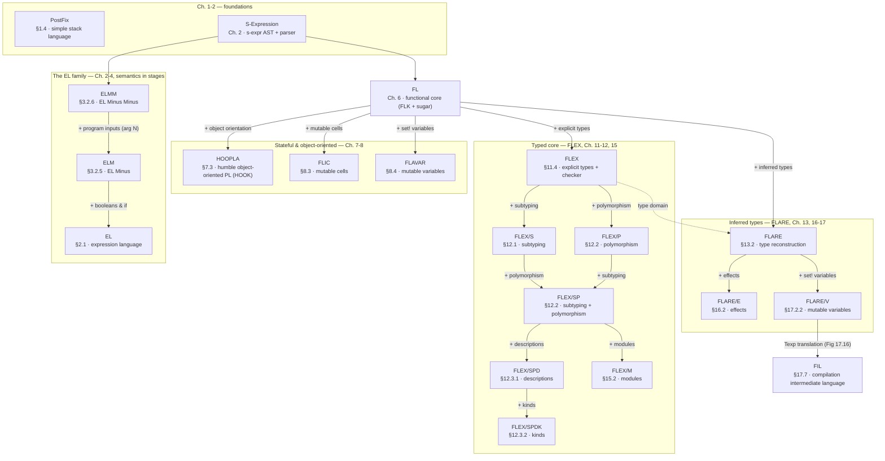

# Design Concepts in Programming Languages — Mini-Language Implementations

Reference implementations, in **Scala 3**, of the family of pedagogical
mini-languages used in

> **Franklyn Turbak & David Gifford** (with Mark A. Sheldon),
> *Design Concepts in Programming Languages*, The MIT Press, 2008.
> ISBN 978-0-262-20175-9. (The textbook for MIT 6.821, *Programming Languages*.)

The book teaches the core ideas of programming-language design with a family of
syntactically simple, s-expression-based languages that build on one another.
This repository implements that family — **one language per directory** — each
with a parser (concrete syntax → abstract syntax), a **reference operational
semantics** (an evaluator, or a type checker where the language is typed), and
a ScalaTest suite.

Built with [Mill](https://mill.build) (pinned in [`.mill-version`](.mill-version)).

## The language family

| Directory | Language | Role / mnemonic | Defined in the book | Status |
|-----------|----------|-----------------|---------------------|:------:|
| [`sexp/`](sexp/)    | S‑Expression | s‑expression AST + parser — the foundation | Ch. 2 | ✅ |
| [`postfix/`](postfix/) | PostFix | a simple stack language | §1.4 | ✅ |
| [`el/`](el/)        | EL | Expression Language | §2.1, §4.2 | ✅ |
| [`elmm/`](elmm/)    | ELMM | EL Minus Minus — the most restricted EL stage | §3.2.6, §4.2.3 | ✅ |
| [`elm/`](elm/)      | ELM | EL Minus — a restricted EL | §3.2.5, §4.2.2 | ✅ |
| [`fl/`](fl/)        | FL | Functional Language (kernel **FLK** + sugar) | Ch. 6 | ✅ |
| [`flic/`](flic/)    | FLIC | FL with mutable **cells** | §8.3 | ✅ |
| [`flavar/`](flavar/) | FLAVAR | FL with mutable **variables** | §8.4 | ✅ |
| [`hooPla/`](hooPla/) | HOOPLA | Humble Object‑Oriented PL (kernel **HOOK**) | §7.3 | ✅ |
| [`flex/`](flex/)    | FLEX | FL with **explicit types** (+ type checker) | §11.4, §11.8 | ✅ |
| [`flex_s/`](flex_s/) | FLEX/S | FLEX with **subtyping** | §12.1 | ✅ |
| [`flex_sp/`](flex_sp/) | FLEX/SP | FLEX/S with **polymorphism** | §12.2 | ✅ |
| [`flex_p/`](flex_p/) | FLEX/P | FLEX with **polymorphism** | §12.2 | ✅ |
| [`flex_spd/`](flex_spd/) | FLEX/SPD | FLEX/SP with **descriptions** | §12.3.1 | ✅ |
| [`flex_spdk/`](flex_spdk/) | FLEX/SPDK | FLEX/SPD with **kinds** | §12.3.2 | ✅ |
| [`flex_m/`](flex_m/) | FLEX/M | FLEX/SP with **modules** | §15.2 | ✅ |
| [`flare/`](flare/)  | FLARE | FL with type **reconstruction** (inference) | §13.2, §13.5 | ✅ |
| [`flare_e/`](flare_e/) | FLARE/E | FLARE with **effects** | §16.2 | ✅ |
| [`flare_v/`](flare_v/) | FLARE/V | FLARE with mutable **variables** | §17.2.2 | ✅ |
| [`fil/`](fil/)      | FIL | Functional Intermediate Language (compilation) | §17.7 | ✅ |

Legend: ✅ implemented · ○ planned. The progression follows the book: a
syntactic foundation (`sexp`), an imperative‑flavored stack language
(`postfix`) and an expression language (`el`) for the semantics chapters, a
core functional language and its state/object‑oriented extensions (`fl`,
`flic`, `flavar`, `hooPla`), a typed core and its static‑semantics extensions
(`flex` family), a type‑inference core and its extensions (`flare` family), and
finally a compilation intermediate language (`fil`).

## Family map

How the 20 languages link together — each arrow is the feature the child
adds on top of its parent (the book's own progression):



Solid arrows are the conceptual progression; the dashed arrow marks
machinery *reused* from a sibling branch (FLARE adopts FLEX's type domain).
`postfix` is standalone (§1.4), and `fil` is a target rather than a family
member: the stateful FLARE family is translated *into* it (Fig 17.16).
Code‑level module dependencies in [`build.sc`](build.sc) follow this shape —
a few siblings also reuse each other's code (`flex_p` builds on `flex_sp`,
`flavar` on `flic`, `flare` on `flex`) without changing the conceptual links.

## Repository layout

Each language is a self‑contained [Mill](https://mill.build) module:

```
<lang>/
  README.md      # the language: concrete syntax, abstract syntax, semantics, examples
  src/           # AST + parser (+ reference evaluator / type checker)
  test/src/      # ScalaTest suite
```

Conventions shared across the family (see [`sexp/`](sexp/) for the foundation):

- **Packages** are `DSL.<lang>`.
- **AST nodes** extend the s‑expression base types from `DSL.sexp`
  (`SPTree` → `SymbolicToken` for leaves, `INode` for interior nodes,
  `PhraseTag` for keyword tokens), so every program can be printed as a tree.
- **Parsers** use `scala-parser-combinators` (`RegexParsers`) and read the
  book's s‑expression concrete syntax.
- **Semantics** are given as a reference big‑step evaluator
  (`… : Option[Result]`), where `None` signals a runtime error.
- **Tests** use ScalaTest's `AnyFlatSpecLike` with small `should…` assertions.

## Building & testing

Prerequisites: JDK 17+ and internet access (Mill fetches the Scala 3.1.2
compiler and libraries on first run).

```bash
# run every language's test suite
mill __.test

# run a single language's suite
mill el.test
mill fl.test

# compile only
mill __.compile
```

Mill's version is pinned in [`.mill-version`](.mill-version); any Mill launcher
honors it.

## License

[MIT](LICENSE).
